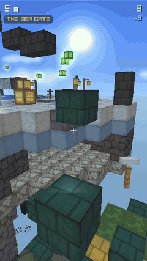
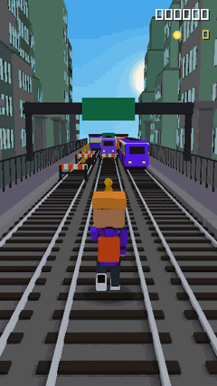
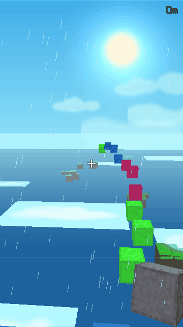

# claude-brainrot

Subway Surfers while your coding agent is thinking.

[](https://github.com/tristanmuzzu/claude-brainrot/actions/workflows/ci.yml)
[](https://pypi.org/project/claude-brainrot/)
[](LICENSE)

A small gameplay strip beside your terminal or agent window. It appears while
the agent works and fades away when the turn ends. Every run is rendered locally
in 3D. No video feed, account, or downloaded game assets.

<p align="center">
  
  
  
</p>

These clips come from the renderer's `brainrot shoot` command.

## Try it

Python 3.11+, Windows 10/11 or Linux with a graphical desktop.

```bash
pipx install claude-brainrot
brainrot demo --scene runner
```

`uv tool install claude-brainrot` works too. The demo needs no hooks or running
agent. Arrow keys or WASD let you play the runner; leave it alone and autopilot
takes over.

**GitHub source is ahead of PyPI 0.3.0.** Install from source below for Codex
hooks and the latest tower fixes. The PyPI release supports Claude Code.

## Set up the overlay

With the source version installed:

```bash
brainrot install --agent claude
brainrot doctor --agent claude
brainrot run
```

For **local Codex Desktop or CLI**, use `--agent codex` for install and doctor.
Local ChatGPT Work uses the same integration (`--agent chatgpt` is an alias).
Review and trust the registered hooks in your agent, then restart it. Cloud
chats and ordinary ChatGPT conversations do not run these local hooks.

On **GNOME/Wayland**, installation also copies a small shell extension. Run
`brainrot extension load` and follow its instructions, or log out and back in.
The extension lets the strip follow the focused agent window. Without it,
the strip uses the desktop's work area instead. Other Linux desktops use that
fallback too.

Keep one `brainrot run` process open. It handles both agents. Use `brainrot
doctor` before starting another copy. Full setup, checks and removal:
[INSTALL.md](INSTALL.md).

## Send your agent here

Paste this into Claude Code, Codex, Cursor, or another local agent:

> Install https://github.com/tristanmuzzu/claude-brainrot on this computer.
> Read AGENTS.md and INSTALL.md. Use the source version, preserve my existing
> hooks, and verify a demo before enabling the overlay for my coding agent.

## What plays

| Scene | What you get |
| --- | --- |
| `runner` | Three lanes, coins, trains, roof jumps and an autopilot. |
| `parkour` | First-person jumps over islands and clouds. |
| `tower` | A climbing course with 33 authored levels and 385 landings. |
| `spiral` | A generated course wrapped around a tower. Optional rotation. |

The default rotation includes runner, parkour and tower. Seeds vary the course,
palette, weather and time of day. Replay one with
`brainrot demo --scene tower --seed 4712`.

The strip waits 1.5 seconds before appearing, never takes keyboard focus, and
lets clicks through. With the GNOME extension or Windows backend, it follows
your agent window and hides when you switch away. Hold Ctrl+Alt to drag it.
On GNOME, the game-controller button in the top bar switches it off.

## Configuration

Run `brainrot doctor` to find your `config.toml`. Common settings:

```toml
[window]
width = 360
height = 640

[content]
scenes = ["runner", "parkour", "tower"]
quality = "high"
```

See [the full example](config.example.toml) for timing, placement and focus
settings. Windows needs Python from python.org rather than Microsoft Store
Python, whose redirected config paths can cause settings to be missed.

## Build or contribute

```bash
git clone https://github.com/tristanmuzzu/claude-brainrot.git
cd claude-brainrot
python3 -m venv .venv
# Linux:
source .venv/bin/activate
# Windows PowerShell instead: .\.venv\Scripts\Activate.ps1
python -m pip install -e ".[dev]"
python -m pytest tests/
```

Tests need a renderer appropriate to the environment. Keep the GPU wheel on a
real desktop. For headless CI, use an isolated environment with
`raylib-software`; do not replace your live installation's renderer.
Platform-specific skips do not establish overlay behavior on that platform.

[Architecture](docs/ARCHITECTURE.md) · [Hooks](docs/HOOKS.md) ·
[Tower design](docs/TOWER.md) · [Probes](docs/PROBES.md) ·
[Known issues](FINDINGS.md)

The models ship with their editable Blender scripts in `assets/src/`. Blender
is only needed to rebuild assets, not to install or run the app.

## Platforms and privacy

Windows and GNOME/Wayland have the full overlay integration. Other Linux
desktops use work-area docking. macOS can run scenes in a plain window, but
has no overlay backend.

Hooks send lifecycle events and process/window identifiers over loopback.
They do not forward prompts, file contents or keystrokes. The GNOME extension
shares window geometry and pointer position locally. No telemetry.

MIT. Not affiliated with Anthropic, OpenAI, Mojang or the Subway Surfers team.
If you try it, an issue with your platform and `brainrot doctor` output helps.
